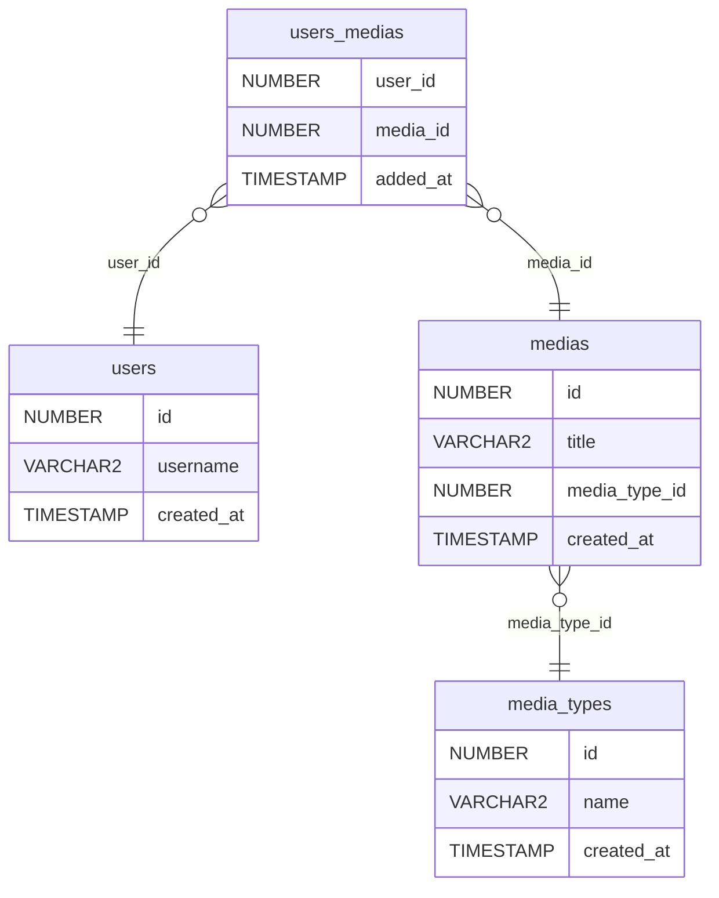

# media-database-oracle

This small **Oracle** database was created for educational purposes.
Use it for your web apps, native apps, or any stack your practicing with.

This can be helpful for Front End Developers who want to quickly set up an
experimental database and stay focused on their core work, without delving into
database design. It also serves as a basic template for building custom
databases.

Requires **Oracle Database 12c or later** (uses identity columns). The dev
container runs **Oracle Database 23 Free** via Docker.

Below is the ERD (edit [`ddl.mmd`](ddl.mmd), the Mermaid source):



> Many **users** can have many **medias** of specific **media_types**: VHS,
DVD, Blu-ray, etc.

### File prefixes
SQL files are prefixed by **ddl**, **dml**, and **dql** for convenience.

### Data examples
Some medias are ficticious, as well as default users.

## Quick start (Dev Container)

You need **Docker**. In **Cursor**, use **Reopen in Container** (Dev Containers
spec; `.devcontainer/` — same layout as VS Code).

1. Open this folder and run **Dev Containers: Reopen in Container**.
2. On first create, **postCreateCommand** downloads Instant Client, Temurin 21,
   and SQLcl (~200MB+) and can take **10–15 minutes** (clients are cached in
   Docker volumes for later recreates). No custom `docker build` is required.
3. Wait for the Oracle image to start (first time can take several minutes while
   the database initializes).
4. On first create, `postCreateCommand` runs [`.devcontainer/init-db.sh`](.devcontainer/init-db.sh),
   which uses **SQL\*Plus** to apply **ddl.sql** and the **dml-\*.sql** files in order.

### Connection details

| Setting | Value |
|--------|--------|
| User | `media` |
| Password | `media` |
| Service | `FREEPDB1` |
| From inside the dev container | `media/media@127.0.0.1:1521/FREEPDB1` (DB on `localhost` via shared network) |
| From your host (port **1521** forwarded) | `media/media@localhost:1521/FREEPDB1` |

The dev container includes both **SQL\*Plus** (Instant Client, native) and
**SQLcl** (`sql`, JVM). Integrated terminals pick up `PATH` and `JAVA_HOME`
automatically; in an outside shell run `. /etc/profile.d/oracle-dev.sh` once per
session. Same connect string for either tool:

```bash
sqlplus media/media@//127.0.0.1:1521/FREEPDB1
sql media/media@//127.0.0.1:1521/FREEPDB1
```

Use SQL Developer or another client on your host with the forwarded port if you
prefer a GUI.

### Sample query

```bash
# Legacy-style client
sqlplus -S media/media@//127.0.0.1:1521/FREEPDB1 @dql-get-user-collection.sql

# Modern client (JSON/CSV options, etc.)
sql -S media/media@//127.0.0.1:1521/FREEPDB1 @dql-get-user-collection.sql
```

### Reset the database

Schema and data live in a Docker volume. From the project root on your host:

```bash
docker compose -f .devcontainer/docker-compose.yml down -v
```

Then **Rebuild Container** in the editor.

## SQL files (manual order)

If you apply scripts yourself (for example after schema changes), use this order:

1. **ddl.sql** — tables and relationships
2. **dml-media-types.sql**
3. **dml-medias.sql**
4. **dml-users.sql**
5. **dml-users-medias.sql**

### dql

Use **dql-get-user-collection.sql** as a template, swapping literal values for
bind variables in your application stack.
